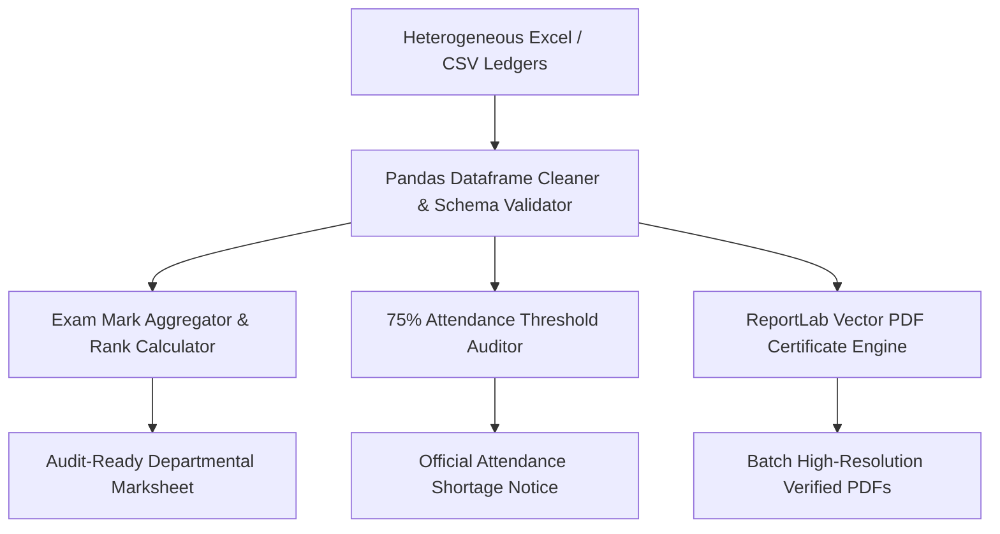

# TK-Office — Institutional Administrative Productivity Automation Suite

[](https://python.org/)
[](https://pandas.pydata.org/)
[](https://www.reportlab.com/)
[](LICENSE.md)

**TK-Office** is an internal office automation and institutional administration toolkit. It automates repetitive clerical workflows including student batch spreadsheet normalization, automated PDF certificate generation from templates, mark list consolidation, and attendance aggregation across academic departments.

---

## Problem Statement & Context
College and departmental offices lose hundreds of administrative hours to manual data entry:
- **Disorganized Student Mark Spreadsheets**: Faculty submit internal exam marks in inconsistent formats with missing student register numbers and formula errors.
- **Manual Certificate Generation**: Designing and populating hundreds of event participation certificates by hand takes days of repetitive graphic design work.
- **Attendance Ledger Consolidation**: Merging daily hour-by-hour attendance logs into semester eligibility reports is prone to calculation errors.

---

## Existing Solutions & Critical Gaps
| Administrative Task | Manual Clerical Workflow | TK-Office Automation |
| :--- | :--- | :--- |
| **Mark List Consolidation** | 4–6 hours per exam batch | **<5 seconds via Pandas script** |
| **500 Event Certificates** | 2–3 days in Photoshop/Canva | **<30 seconds via ReportLab vector rendering** |
| **Attendance Percentage Audit** | Multi-day cross-referencing | **Automated audit report with threshold flagging** |

---

## Proposed Solution & Architectural Innovation
TK-Office provides **Deterministic Clerical Automation Scripts**:
- **Intelligent Spreadsheet Normalizer**: Parses heterogeneous Excel/CSV submissions, enforces schema integrity (register number format, mark boundaries), and flags discrepancies.
- **Parametric Vector Certificate Generator**: Ingests recipient lists and dynamically populates institutional vector PDF certificates with custom typography and verification QR codes.
- **Cohort Attendance Aggregator**: Computes overall and subject-wise attendance percentages, automatically isolating students falling below mandatory 75% thresholds.

---

## Technical Approach & System Architecture


---

## Quantifiable Impact & Measurable Benefits
- **95% Reduction in Administrative Processing Time**: Tasks that previously took days are executed in seconds.
- **100% Elimination of Clerical Calculation Errors**: Standardized mathematical formulas ensure accurate mark percentages.
- **Instant Departmental Compliance**: Formats outputs strictly to VSBEC departmental reporting standards.

---

## Feasibility, Operational Viability & Scalability
- **Lightweight & Portable**: Runs on any office computer with standard Python without requiring database installation.

---

## Project Architecture & Quickstart
```bash
git clone https://github.com/Tharun4743/TK-Office.git
cd TK-Office
pip install -r requirements.txt
python main.py
```

---

## Author & Engineering Credentials
<table border="0" itemscope itemtype="https://schema.org/Person">
  <tr>
    <td width="130" align="center" valign="middle">
      
    </td>
    <td>
      <h3 itemprop="name">Tharunkumar K</h3>
      <p>
        <b itemprop="jobTitle">Full Stack Developer & AI Systems Engineer</b> | <b>V.S.B. Engineering College (VSBEC)</b><br/>
        🎓 <b>B.Tech in Information Technology</b> — <b>V.S.B. Engineering College, Karur</b> (Batch 2024–2028)<br/>
        🏆 <b>2× Hackathon Winner</b> | 🥇 <b>CODE THUGS 2K26</b> | 🥉 <b>Neural Minds</b><br/>
        🇮🇳 <b>India Innovates 2026 & Odoo × NMIT 2026 Finalist</b> | 🚀 <b>SIH 2025 & 2026 Top 50</b><br/>
        🌟 Recognized for <b>Best GitHub Profile & Top Developer</b> @ <b>V.S.B. ENGINEERING COLLEGE</b>
      </p>
      <p>
        🚀 <b>Top Flagship Engineering Projects:</b><br/>
        • 🏛️ <b>TaskManager (VSBEC IT Vault)</b> — Institutional Task Governance & LeetCode/GitHub Sync &nbsp;<a href="https://github.com/Tharun4743/Taskmanager"></a>&nbsp;<a href="https://it-taskmanager.vercel.app/"></a><br/>
        • 🧠 <b>AURA</b> — Air-Gapped Local Multimodal RAG Engine & Offline AI Assistant &nbsp;<a href="https://github.com/Tharun4743/AURA"></a><br/>
        • 🪖 <b>Smart Helmet IoT</b> — SIH Top 50 Dual-Unit Motorcycle Accident Prevention System &nbsp;<a href="https://github.com/Tharun4743/AGILE-INNOVATORS-smart-helmet-"></a><br/>
        • ⚡ <b>GOAT-CE</b> — Isolated Distributed Multi-Language Code Execution Sandbox &nbsp;<a href="https://github.com/Tharun4743/GOAT-CE"></a>
      </p>
      <p>
        <a href="https://tharunkumark4743.netlify.app/"></a>&nbsp;
        <a href="https://github.com/Tharun4743"></a>&nbsp;
        <a href="https://www.linkedin.com/in/tharunkumark4743"></a>&nbsp;
        <a href="https://leetcode.com/u/Tharunkumar__K/"></a>&nbsp;
        <a href="mailto:tharunkumark42007@gmail.com"></a>
      </p>
    </td>
  </tr>
</table>
